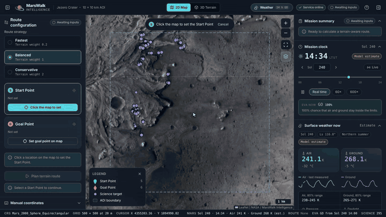
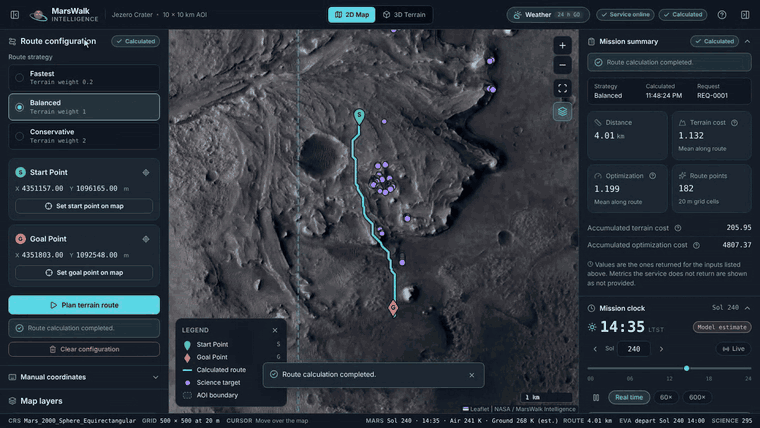
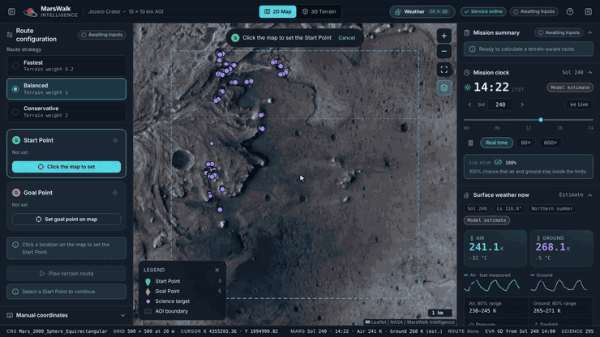
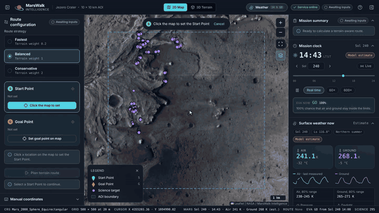
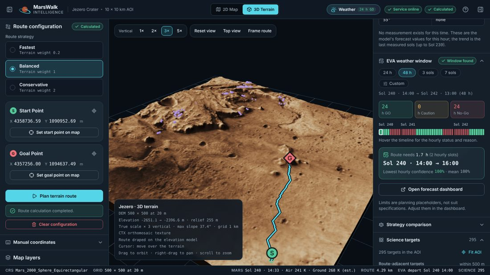
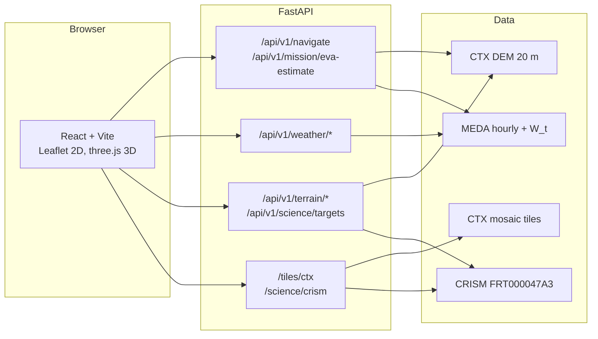

# MarsWalk Intelligence

Terrain-aware and weather-aware EVA route planning for **Jezero Crater, Mars**. Pick a start and a goal, choose a strategy, and get a walkable route on real orbital terrain, the time window that route fits into, and an estimate of what the walk costs in time, energy and oxygen.

Built for the NASA Space Apps Challenge by team Red Horizon Pioneers.

**Live demo:** https://marswalk-intelligence-three.vercel.app/ (the backend sleeps when idle, so the first request after a pause can take a while)

<p align="center">
  
</p>

<p align="center"><sub>Pick two points, plan, then read the weather window and the tagged EVA estimate. Recorded from the app in this repository.</sub></p>

> **Planning prototype, not an operational tool.** Every limit, coefficient and threshold the app uses is labelled in the interface as measured, calculated, modeled or assumed. Nothing here is validated against EVA or rover data. See [docs/SCIENTIFIC_LIMITATIONS.md](docs/SCIENTIFIC_LIMITATIONS.md) before quoting any number.

---

## What it does

| | |
|---|---|
| **Route planning** | 8-direction A* over a 500 x 500 DEM at 20 m (10 x 10 km). Three strategies (Fastest, Balanced, Conservative) trade distance against terrain cost. Slopes above 20 degrees are blocked. |
| **Weather-aware cost** | A regional weather index W_t, built from Perseverance MEDA data, raises the cost of sloped cells. Flat ground is never affected. |
| **EVA estimate** | Duration, energy, oxygen and suit time per route segment, computed on the server from the planned route. |
| **Hourly forecast** | 1 to 7 sol air and ground temperature forecast with calibrated uncertainty, turned into GO, CAUTION and NO-GO hours. The route is fitted into the best GO window. |
| **Science context** | 295 CRISM spectral candidates in the area, reported as candidates near the route. They are not confirmed minerals. |
| **3D terrain** | The same DEM and CTX imagery in 3D, with the route draped on the surface. |
| **Guided tour** | A 19-step walkthrough built into the app. |

## See it work

<table>
<tr>
<td width="50%"><br><b>Three strategies, one pair of points.</b> The routes diverge and a comparison table reports distance and terrain cost.</td>
<td width="50%"><br><b>Forecast, performance and method.</b> The dashboard shows what the model gets right, and where it does not beat a naive baseline.</td>
</tr>
<tr>
<td width="50%"><br><b>Map layers.</b> Slope, elevation and CRISM signal over the CTX mosaic.</td>
<td width="50%"><br><b>3D terrain.</b> Vertical exaggeration, top view and frame-route controls.</td>
</tr>
</table>

A step-by-step script for showing all of this is in [docs/DEMO_GUIDE.md](docs/DEMO_GUIDE.md).

## How it fits together



Details, request flow and the cost model are in [docs/ARCHITECTURE.md](docs/ARCHITECTURE.md).

## Documentation

| Document | Read it for |
|---|---|
| [docs/DEMO_GUIDE.md](docs/DEMO_GUIDE.md) | A 5-minute walkthrough with exact points to click and what to say |
| [docs/ARCHITECTURE.md](docs/ARCHITECTURE.md) | Components, API, cost model, EVA model, deployment |
| [docs/DATA_PROVENANCE.md](docs/DATA_PROVENANCE.md) | Where every dataset comes from, its licence, and how it was processed |
| [docs/SCIENTIFIC_LIMITATIONS.md](docs/SCIENTIFIC_LIMITATIONS.md) | What the numbers do and do not mean |
| [docs/WEATHER.md](docs/WEATHER.md) | Forecast model, endpoints, retraining |
| [docs/EVA_WEATHER_ROUTING.md](docs/EVA_WEATHER_ROUTING.md) | Weather term in the route cost and the segment EVA model |
| [docs/MEDA_WEATHER_PIPELINE.md](docs/MEDA_WEATHER_PIPELINE.md) | The MEDA processing pipeline that produces W_t |
| [docs/pitch/SETUP.md](docs/pitch/SETUP.md) | Team setup with Kaggle-hosted data |

## Run it locally

You need Python 3.10+ and Node.js.

```bash
git clone https://github.com/Hozaifa-777/marswalk-intelligence.git
cd marswalk-intelligence

# Backend (terminal 1)
pip install -r backend/requirements.txt
cd backend
uvicorn app.main:app --host 0.0.0.0 --port 8000 --reload

# Frontend (terminal 2, from the repository root)
cd frontend
npm install
npm run dev
```

Open http://localhost:5173. The backend serves its own interactive API docs at http://localhost:8000/docs.

The processed Jezero data the backend serves (DEM, CTX tiles, CRISM products) is committed to the repository. The raw rasters and the MEDA weather index are not: see [Data](#data) below.

## Data

| Dataset | Source | Used for |
|---|---|---|
| CTX DEM mosaic, 20 m | USGS Astrogeology, Mars 2020 Science Investigation CTX DEM Mosaic | Terrain, slope, routing, 3D |
| CTX orthomosaic, 5 m | USGS Astrogeology, Mars 2020 Science Investigation maps | Map tiles and 3D texture |
| CRISM FRT000047A3 | NASA PDS, Mars Reconnaissance Orbiter | Science candidates and overlay |
| MEDA | NASA PDS, Mars 2020 Perseverance | Forecast model and weather index |

Full details, licences and processing steps are in [docs/DATA_PROVENANCE.md](docs/DATA_PROVENANCE.md).

**Weather index availability.** The route weather term reads `data/resources/MEDA_Weather_ds/processed/weather_intensity.parquet`. That folder is git-ignored. Without the file the API still plans routes, with weather switched off, and the response says so (`weather_status: "unavailable"`, `confidence: "reduced"`). The forecast dashboard does not depend on it.

## Tests

```bash
cd backend
pytest                                                  # synthetic DEM and weather index
pytest --run-slow tests/test_real_dem_integration.py    # real DEM, needs the data
python -m unittest discover -s tests/weather -t .       # MEDA pipeline
```

## Tech

Backend: FastAPI, NumPy, pandas, rasterio, LightGBM, pyarrow, pydantic.
Frontend: React 19, Vite, Leaflet and react-leaflet, three.js with react-three-fiber and drei.
Deployed as a Vite build on Vercel and a FastAPI service on Render.

## Team

Red Horizon Pioneers, NASA Space Apps Challenge 2026. Frontend and the weather forecast model: Abdu. See the repository contributors for the rest of the team.

## Licence

Code is released under the [MIT License](LICENSE). The data products keep the terms of their original publishers, summarised in [docs/DATA_PROVENANCE.md](docs/DATA_PROVENANCE.md).
