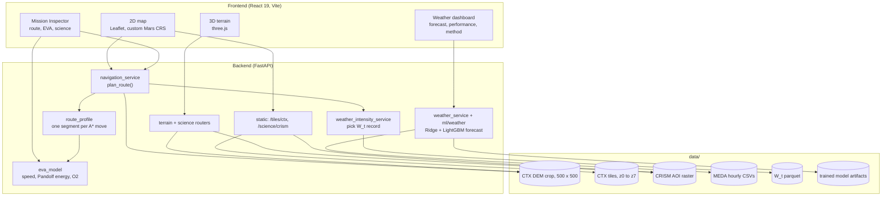
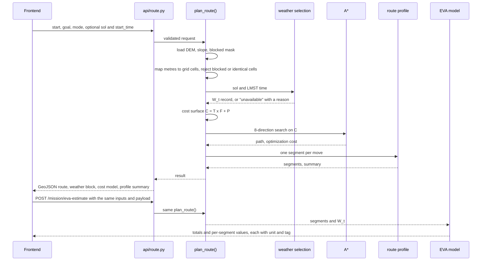

# Architecture

How MarsWalk is put together: the pieces, how a route request flows through them, the cost and EVA models, and how it is deployed.

**Contents:** [Overview](#overview) · [Repository layout](#repository-layout) · [Route request flow](#route-request-flow) · [Cost model](#cost-model) · [EVA model](#eva-model) · [Weather subsystem](#weather-subsystem) · [API](#api) · [Frontend](#frontend) · [Configuration](#configuration) · [Deployment](#deployment) · [Testing](#testing) · [Design decisions](#design-decisions)

---

## Overview



Three ideas shape the design:

1. **The server does the science, the browser shows it.** Routing, weather selection, per-segment EVA values and forecasts are computed in the backend. The frontend sends a start, a goal, a strategy and a payload, and never sends distance, slope or terrain cost.
2. **Every number carries a tag.** `measured`, `calculated`, `modeled` or `assumed`, from the API through to the interface. See [SCIENTIFIC_LIMITATIONS.md](SCIENTIFIC_LIMITATIONS.md).
3. **Missing data is stated, not hidden.** If the weather index is not available the route is planned without it and the response says so. W_t is never replaced by zero.

---

## Repository layout

```
marswalk-intelligence/
├── backend/
│   ├── app/
│   │   ├── main.py                    FastAPI app, CORS, gzip, static mounts, routers
│   │   ├── api/                       HTTP layer: route, mission, terrain, science, weather
│   │   ├── schemas/                   pydantic request and response models
│   │   ├── services/
│   │   │   ├── navigation_service.py  plan_route(): the shared pipeline
│   │   │   ├── route_service.py       cost surface and A* wiring
│   │   │   ├── route_profile.py       per-segment route description
│   │   │   ├── weather_intensity_service.py   W_t record selection
│   │   │   ├── weather_service.py     forecast service for the dashboard
│   │   │   └── weather/               MEDA pipeline that produces W_t
│   │   ├── core/
│   │   │   ├── eva_config.py          every model constant, tagged, with env overrides
│   │   │   ├── routing/               astar, cost_function, route_modes, weather_cost
│   │   │   ├── terrain/               GeoTIFF loading, slope, blocked mask
│   │   │   └── science/               CRISM loader, targets, EVA model
│   │   └── ml/weather/                features, model, trained artifacts
│   └── tests/
├── frontend/src/
│   ├── App.jsx                        state, route lifecycle, layout
│   ├── api/                           one module per backend area
│   ├── components/                    MarsMap, Terrain3D, MissionInsights, Weather, Tour, ui
│   └── utils/                         CRS, mission clock, route status, formatting
├── data/                              raw, processed, weather (see DATA_PROVENANCE.md)
├── scripts/                           data bootstrap, AOI crop, CRISM, model training
├── notebooks/                         the 7 numbered scripts that prototyped terrain and A*
└── docs/
```

---

## Route request flow

`POST /api/v1/navigate` and `POST /api/v1/mission/eva-estimate` both call the same function, `plan_route()`, so a route and its EVA estimate can never disagree about the path.



**Status codes** for both endpoints:

| Code | Meaning |
|---|---|
| 200 | Route found |
| 400 | Invalid input: outside the raster, blocked start or goal, same cell, bad time. `/eva-estimate` also answers schema errors with 400 |
| 404 | No route exists |
| 422 | Schema error on `/navigate`, or W_t required by configuration but unavailable |
| 503 | DEM unavailable |

---

## Cost model

Grid: 500 x 500 cells at 20 m. Moves in 8 directions. Move length is 20 m, or 20 x sqrt(2) m on a diagonal.

```
C_t(i) = 1 + (slope_i / s_ref)^2            terrain cost, ratio clipped to 1, so 1 <= C_t <= 2
T(i)   = 1 + w * (C_t(i) - 1)               w = strategy weight
s(i)   = clip(slope_i / s_ref, 0, 1)
F(i)   = 1 + beta * W_t * s(i)              weather factor, exactly 1 on flat cells
P(i)   = 0                                  weather penalty (off by default)
C(i)   = T(i) * F(i) + P(i)                 infinite where slope > 20 degrees or NoData
```

| Strategy | Terrain weight w |
|---|---|
| Fastest | 0.2 |
| Balanced | 1.0 |
| Conservative | 2.0 |

- `s_ref` is the 95th percentile of slope in the AOI (9.61 degrees), reported as `reference_slope_deg`.
- `beta = 0.5`, tagged `modeled`. `W_t` is in [0, 1].
- The A* objective, `optimization_cost`, is the sum over moves of move length (m) times the destination cell cost. The start cell is excluded.
- **Admissibility.** Every finite cell cost is at least 1 (C_t at least 1, w at least 0, F at least 1, P at least 0). The octile heuristic assumes a minimum cost of 1 per move, so it never overestimates. This is covered by a test against an exact search.

Source: `core/routing/cost_function.py`, `route_modes.py`, `weather_cost.py`, `astar.py`.

---

## EVA model

Built from the route profile: one segment per A* move, each taking the terrain of its destination cell (the cell A* charged for that move).

```
v     = v0 / (1 + k_t (C_t - 1)) / (1 + k_s * slope_percent)      k_t = 0.15, k_s = 0.02
t     = distance / v
M [W] = 1.5 W + 2.0 (W+L)(L/W)^2 + eta (W+L)(1.5 V^2 + 0.35 V G)   Pandolf, Givoni and Goldman 1977
energy [kcal] = M * 0.859845 * hours
O2 [L]        = energy / 4.86
suit time %   = duration / suit capacity * 100
```

`W` is body mass (80 kg), `L` is suit plus payload (100 kg plus the user's payload), `V` is the segment speed and `G` the uphill grade in percent. The load-support and grade terms are scaled by 3.71 / 9.80665 for Mars gravity. `C_t` in the speed formula is the raw terrain cost, not the strategy-weighted one, so the same ground is walked at the same speed whichever strategy found it.

Defaults: v0 0.75 m/s, suit capacity 8.5 h, payload set by the user (the only EVA input in the interface). Totals are sums of segments. The average rate is checked against 100 to 500 kcal/h, and an out-of-range value is reported with its clamped counterpart and a warning.

Each value in the response is `{ value, unit, tag }`. Source: `core/science/eva_model.py`, constants in `core/eva_config.py`. Full derivation: [EVA_WEATHER_ROUTING.md](EVA_WEATHER_ROUTING.md).

---

## Weather subsystem

Two independent uses of MEDA data.

| | Forecast | Route weather index W_t |
|---|---|---|
| Purpose | Hourly temperature, GO and NO-GO hours | One number that nudges slope cost |
| Code | `ml/weather/`, `services/weather_service.py`, `api/weather.py` | `services/weather/`, `services/weather_intensity_service.py`, `core/routing/weather_cost.py` |
| Input | `data/weather/meda/*.csv`, Sols 1 to 239 shipped | `weather_intensity.parquet`, Sols 230 to 239 |
| Trained or built | Trained once, artifacts loaded at startup | Built by the MEDA pipeline, read at request time |
| Time basis | Local true solar time, hourly | LMST, nearest valid record within 1,800 s of the same sol |
| In the repo | Yes | Not by default (git-ignored) |

**Forecast model.** Baseline is the same-hour mean of the previous 7 sols. Ridge and LightGBM predict the residual per lead (1 to 7) on 67 features and are blended with shrinkage weights. Split-conformal intervals by lead and hour give quantiles, and the probability that air and ground both stay inside the limits comes from paired errors. Status: GO at P of at least 80 percent, CAUTION at 50 percent, otherwise NO-GO, and night is always NO-GO. Details and test results: [WEATHER.md](WEATHER.md).

**Fitting a route into a window.** The frontend takes the route duration from the EVA estimate and picks the hourly slots with the best lowest-hour confidence, earliest on ties. The window is shown in the Mission Inspector.

**Mission clock.** The weather panels follow a simulated Mars clock (real time, 60x or 600x, scrubbable, jump to any sol). On a sol with data the panel shows what MEDA measured up to the clock time. After the last data it shows the model estimate and says so.

---

## API

Interactive docs while the backend runs: `/docs`. The OpenAPI document at `/openapi.json` is the source of truth for schemas.

| Method | Path | Purpose |
|---|---|---|
| GET | `/health` | Liveness check |
| GET | `/` | Service name and status |
| POST | `/api/v1/navigate` | Weather-aware route as a GeoJSON LineString, with a weather block, cost model and profile summary. `include_profile` adds every segment |
| POST | `/api/v1/mission/eva-estimate` | EVA totals and per-segment values for the route the server plans |
| POST | `/api/v1/mission/consumables` | Deprecated. Trusts client-supplied distance and terrain cost |
| GET | `/api/v1/science/targets` | CRISM candidate targets as GeoJSON |
| GET | `/api/v1/terrain/heightmap` | Elevation, slope and valid mask. `max_dimension` 32 to 512, the frontend asks for 500 |
| GET | `/api/v1/terrain/texture` | 500 x 500 CTX texture for the 3D view |
| GET | `/api/v1/weather/status` | Model availability, sol range, default limits |
| GET | `/api/v1/weather/current` | Conditions at a sol and hour |
| GET | `/api/v1/weather/forecast` | Hourly forecast, limits and route window parameters |
| GET | `/api/v1/weather/report` | Evaluation report behind the Performance and Method tabs |
| GET | `/tiles/ctx/{z}/{x}/{y}.png` | CTX tile pyramid, cached for a day |
| GET | `/science/crism/*` | CRISM overlay and metadata |

Example:

```bash
curl -X POST http://localhost:8000/api/v1/navigate \
  -H "content-type: application/json" \
  -d '{"start":[4351157,1096165],"goal":[4351803,1092548],"mode":"balanced"}'
```

---

## Frontend

React 19 and Vite. Leaflet and react-leaflet render the 2D map in a custom CRS. three.js through react-three-fiber and drei renders the 3D view. lucide-react supplies icons, with Inter and IBM Plex Mono for type.

| Area | Where | Notes |
|---|---|---|
| Map CRS | `utils/marsCRS.js`, `mapConfig.js` | `Mars_2000_Sphere_Equirectangular`, XYZ tiles, 256 px, native zoom 7. Leaflet `[lat, lng]` is `[Mars Y, Mars X]` |
| Route lifecycle | `App.jsx`, `utils/routeStatus.js` | Awaiting inputs, Ready, Calculating, Calculated, Outdated, Error. Changing an input marks the route Outdated until it is recalculated |
| 3D terrain | `components/MarsMap/Terrain3D.jsx` | Full 500 x 500 heightmap, CTX texture, route draped on the surface, science targets, vertical exaggeration 1x to 5x, Reset, Top view and Frame route |
| Mission Inspector | `components/MissionInsights/` | Summary, strategy comparison, science targets, EVA resources, provenance |
| Weather | `components/Weather/` | Now, EVA window, dashboard with Forecast, Model performance and Method tabs |
| Tour | `components/Tour/` | 19 steps |
| Health check | `App.jsx`, `api/system.js` | Retries while the backend wakes, shows "Service offline" only after repeated failure |

The base URL comes from `VITE_API_BASE_URL`, read at build time. In development the Vite server proxies API and tile requests to port 8000.

---

## Configuration

Environment variables for the backend. All are optional.

| Variable | Default | Effect |
|---|---|---|
| `MARSWALK_WEATHER_INTENSITY_PATH` | `data/resources/MEDA_Weather_ds/processed/weather_intensity.parquet` | Where to read W_t |
| `MARSWALK_WEATHER_BETA` | 0.5 | Strength of the weather term. Must be 0 or more |
| `MARSWALK_WEATHER_REQUIRED` | off | Answer HTTP 422 instead of planning without weather |
| `MARSWALK_WEATHER_WINDOW_S` | 1800 | Selection window, in LMST seconds |

Frontend build variable: `VITE_API_BASE_URL`, the public URL of the backend.

---

## Deployment

| Part | Host | Settings |
|---|---|---|
| Frontend | Vercel | Vite project in `frontend/`, env `VITE_API_BASE_URL` set to the Render URL |
| Backend | Render web service | Repository root as Root Directory. Build `pip install -r backend/requirements.txt`. Start `cd backend && uvicorn app.main:app --host 0.0.0.0 --port $PORT` |

Notes from running it:

- **The data ships with the code.** The backend needs the processed DEM, the 7,490 tile files and the CRISM products at start. They are allow-listed in `.gitignore` and committed, with no Git LFS. This is why the Render root must be the repository root and not `backend/`.
- **Two Git remotes.** The team repository and the repository Render and Vercel deploy from can differ. A push has to reach the one the hosts watch.
- **Cold starts.** On a free instance the first request after idle can take tens of seconds. The frontend retries before it shows an offline banner.
- **The W_t file is not deployed** unless you un-ignore and commit it (about 9 MB), or set `MARSWALK_WEATHER_INTENSITY_PATH` to a file on the host. Without it routes are planned with weather off.
- **The forecast model is deployed.** The artifacts (about 11 MB) are committed and loaded at startup. The backend never retrains.

---

## Testing

```bash
cd backend
pytest                                                  # cost, A*, modes, route profile, weather cost and selection, EVA model and API, science, terrain
pytest --run-slow tests/test_real_dem_integration.py    # needs the real DEM
python -m unittest discover -s tests/weather -t .       # MEDA pipeline: discovery, labels, units, W_t, storage, end to end
```

Most tests use a synthetic DEM and a synthetic W_t file, so they run without the data.

---

## Design decisions

| Decision | Reason |
|---|---|
| Weather multiplies the whole terrain part, not just the slope term | Flat ground then costs exactly the same with or without weather, and weather scales the cost of slopes, which is what makes a flat detour attractive when W_t is high |
| Speed uses raw terrain cost, not the strategy-weighted one | A strategy is a planner preference. It should not change how fast the same ground can be walked. `speed_uses_mode_weighted_terrain` restores the other reading |
| `/eva-estimate` re-plans on the server | The old endpoint trusted a distance and terrain cost sent by the client, which could disagree with the route on screen |
| 400 for bad input on `/eva-estimate` | 422 is reserved for "weather required but unavailable" on this route |
| Missing W_t means F = 1, with a flag | Silently using 0 would present "no weather" as "calm weather" |
| One segment per A* move, none merged | Segment values add up to the totals exactly, and the A* objective can be recomputed from the segments (checked in a test) |
| Weather penalty P off, with a gate | A penalty needs a written scientific justification before it can be switched on |
