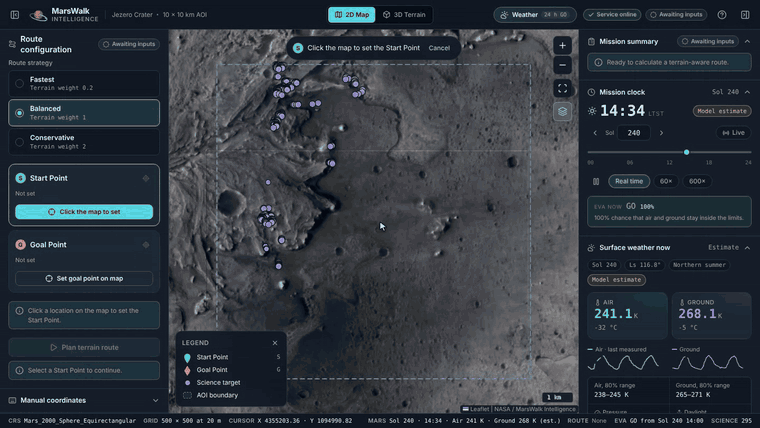
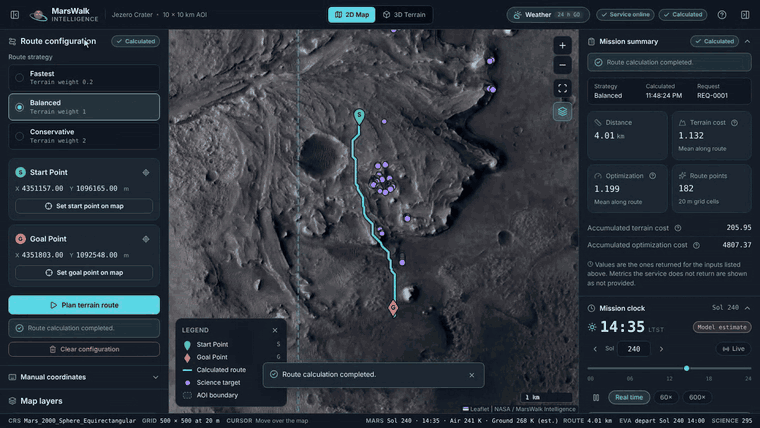
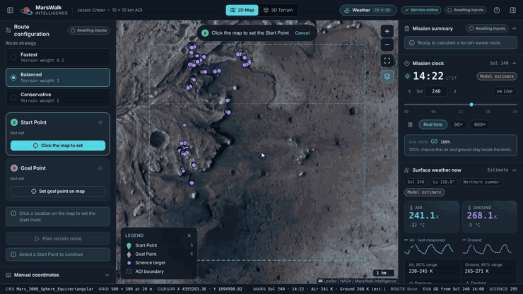
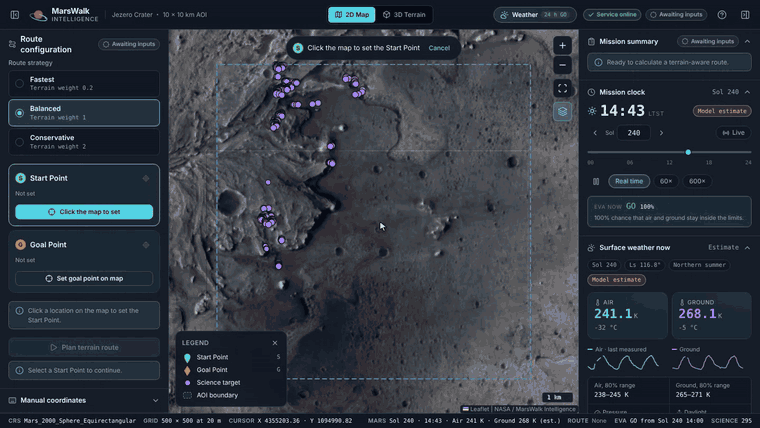
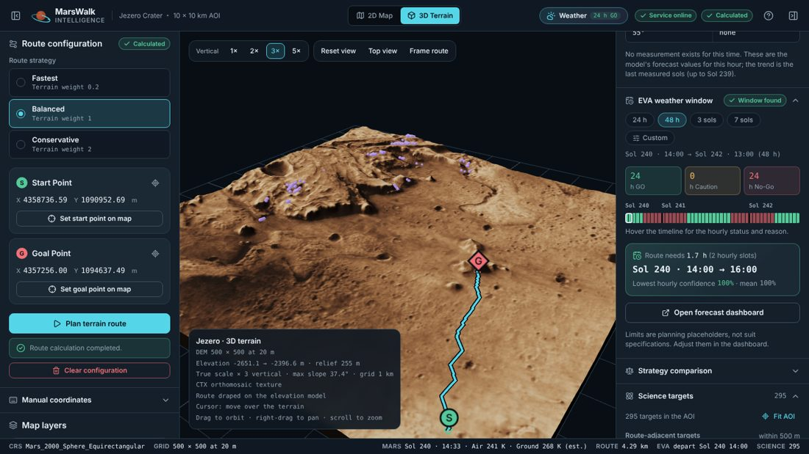

# Demo guide

A 5-minute walkthrough of MarsWalk with exact inputs, what should appear, and what to say. Use it to present live, to record a video, or to check that a deployment works.

**Before you start**

- Open the app: https://marswalk-intelligence-three.vercel.app/ or http://localhost:5173.
- If it is the hosted version, open it a minute early. The backend sleeps when idle and the first request can be slow. Wait for the green **Service online** badge in the top bar.
- Use a window at least 1280 px wide. The animations below were recorded at 1440 x 810.
- The numbers in this guide come from the repository build with the weather index present. Without it (`weather_status: "unavailable"`) distances change slightly. Both versions are listed where it matters.

| Step | What | Time |
|---|---|---|
| 1 | The place and the guided tour | 0:30 |
| 2 | Plan a route | 1:00 |
| 3 | Compare strategies | 0:45 |
| 4 | Weather window and EVA estimate | 1:15 |
| 5 | Forecast dashboard, honestly | 1:00 |
| 6 | Map layers, science and 3D | 0:30 |

---

## 1. The place and the guided tour (0:30)

You see Jezero Crater, a 10 x 10 km area where Perseverance works, on 5 m CTX imagery. Purple dots are 295 science candidates.

**Say:** "This is a planning tool for a suited astronaut walk. Real orbital terrain, real rover weather data, and every number tells you how much to trust it."

**Do:** Click the **?** in the top bar. The tour has 19 steps. Show the first two or three (route strategy, start and goal), then close it. Come back to it at the end if there is time.

---

## 2. Plan a route (1:00)

**Do:**

1. Open **Manual coordinates** in the left panel and enter:

   | | X | Y |
   |---|---|---|
   | Start | 4351157 | 1096165 |
   | Goal | 4351803 | 1092548 |

   Apply each. (Or click two points on the map. Any two walkable points work.)
2. Leave the strategy on **Balanced** and press **Plan terrain route**.

**You should see:** a cyan route about 4 km long, with S and G markers. **Mission summary** shows distance, mean terrain cost, optimisation cost and the number of 20 m grid points.

| | Distance | Mean terrain cost |
|---|---|---|
| Balanced, weather applied | about 4.01 km | 1.132 |
| Balanced, weather off | about 3.98 km | 1.140 |

**Say:** "A* on a 500 by 500 grid, 20 metres a cell. Cost comes from slope. Anything steeper than 20 degrees is blocked, and that number is a placeholder, not a safety limit."

---

## 3. Compare strategies (0:45)

**Do:**

1. Pick **Fastest** and press **Recalculate route**. The old route turns dashed and orange, labelled *Outdated*, until you do.
2. Pick **Conservative** and recalculate.
3. In the right panel, open **Strategy comparison** and press **Compare strategies**.

**You should see** the three routes diverge, and a table:

| Strategy | Distance | Mean terrain cost |
|---|---|---|
| Fastest | 3.89 km | 1.181 |
| Balanced | 4.01 km | 1.132 |
| Conservative | 4.03 km | 1.129 |

**Say:** "Fastest takes the shorter, steeper way. Conservative accepts about 140 metres more to keep the terrain easier. On these two points the difference is small, which is itself honest: the choice matters where there is a real trade between a steep short path and a flat long one."

---

## 4. Weather window and EVA estimate (1:15)

Scroll the right panel after planning.

**Surface weather now.** Air and ground temperature for the mission clock time. It is labelled *Model estimate* when no measurement exists for that hour. Point at the clock: it can run in real time, at 60x or 600x, or jump to any sol.

**EVA weather window.** The route needs about 1.7 hours, so the app finds consecutive hourly slots where air and ground stay inside the limits with high probability. It reports the window and the lowest hourly confidence inside it. Hover the timeline to see the reason for each hour.

**Say:** "The route is not just a line. The app asks whether the weather allows walking it, and when."

**EVA resources.** Open the accordion.

| | Value for the Balanced route | Tag |
|---|---|---|
| Duration | about 1.7 h | modeled |
| Suit time used | about 20 percent | calculated |
| O2 estimate | about 170 L | calculated |
| Energy | about 830 kcal | modeled |

(For the demo points above, with a 15 kg payload and the weather index applied.)

Change **Payload** and watch the values update. Everything else is taken from the route the server planned, segment by segment.

**Say:** "Each value says whether it was calculated, modeled or assumed. Speed 0.75 metres per second is an Apollo planning figure. Suit time is a share of time, not of oxygen. None of this is validated against EVA data."

If the interface shows a warning that the average metabolic rate is outside 100 to 500 kcal/h, that is the model flagging itself. Read it out.

---

## 5. Forecast dashboard, honestly (1:00)

**Do:** Click **Weather** in the top bar (or **Open forecast dashboard** in the EVA window).

1. **Forecast.** Hourly air and ground temperature, 1 to 7 sols ahead, with an uncertainty fan and a GO, CAUTION or NO-GO strip. Change the limits in the editor to show that they are inputs.
2. **Model performance.** The part to dwell on. It compares the model with a naive baseline on sols the model never saw.
3. **Method and data.** What data, what splits, what limits.

**Say:** "At one sol ahead the model beats the baseline for air temperature by about 6 percent, and ground temperature by a lot more. At four to six sols ahead, air is slightly worse than the baseline, and the dashboard says so. The 80 percent band covers 72 percent of hours, under what it claims. We show that instead of hiding it."

Numbers to have ready: air +1 sol MAE 1.65 K against 1.76 K for the baseline. Ground +1 sol 1.36 K against 2.26 K.

---

## 6. Map layers, science and 3D (0:30)

**Do:**

1. Open **Map layers** in the left panel. Switch on **Slope**, then switch it off. Switch on **CRISM D2300**.
2. Click a purple science target to see its details. The list **Route-adjacent targets** shows candidates within 500 m of the route.
3. Click **3D Terrain** in the top bar.

In 3D, the route is draped on the surface over the CTX texture. Drag to orbit, right-drag to pan, scroll to zoom. Try **5x** vertical exaggeration, then **Top view** and **Frame route**.

**Say:** "These are candidates, not minerals. Two spectral indices from one orbital scene both rank in the top 5 percent. A real identification needs follow-up."

---

## Questions you will probably get

**Is the route safe?** It is a planning route on a 20 m model of the ground. It cannot see rocks or sand, and the 20 degree limit is a placeholder. It is not a safety assessment.

**How did you build the weather part?** Two parts. A forecast model trained on Perseverance MEDA temperature records, evaluated on held-out sols. And a regional weather index from MEDA air temperature and wind that raises the cost of slopes. The index has one value for the whole area, and its strength (beta = 0.5) is a modeled guess.

**Why does the weather barely change the route?** Because beta is modest and the index is regional. It adds up to 37 percent to the cost of the steepest cells and nothing on flat ground. It is a mechanism, not a result.

**Is the forecast good?** Slightly better than a strong baseline at 1 sol, about equal at 7, slightly worse at 4 to 6 for air temperature. The uncertainty bands are under-confident in coverage. See [SCIENTIFIC_LIMITATIONS.md](SCIENTIFIC_LIMITATIONS.md#weather-forecast).

**Why does replay look so accurate?** Because the deployed model has seen those sols in training. Replay shows behaviour, not accuracy.

**Where does the data come from?** USGS CTX DEM and orthomosaic, CRISM FRT000047A3, and MEDA. See [DATA_PROVENANCE.md](DATA_PROVENANCE.md).

**What would you do next?** Real suit and mobility limits, a hazard layer from HiRISE, validation of the speed and energy model, and a spatial weather field.

---

## If something goes wrong

| Symptom | Likely cause | What to do |
|---|---|---|
| Red **Service offline** banner | Backend asleep, or an ad blocker blocking `/health` | Wait a minute and reload. Try a private window |
| Route button does nothing, map is black | Backend not reachable, or tiles missing | Check `/health` on the backend URL, then `/tiles/ctx/0/0/0.png` |
| EVA resources says weather not applied | The W_t file is not on the server | Expected on the hosted build. Routes still plan, with weather off. See [DATA_PROVENANCE.md](DATA_PROVENANCE.md#4b-the-weather-index-w_t-used-in-route-cost) |
| Start or goal rejected | The cell is blocked (slope above 20 degrees) or outside the area | Move the point |
| Route says *Outdated* | An input changed after the last calculation | Press **Recalculate route** |
| 3D view is slow | No GPU acceleration in the browser | Use a browser with hardware acceleration on |

---

## Re-recording the animations

The GIFs in `docs/assets/` were recorded from the running app with Playwright (Chromium) at 1440 x 810, with a smooth cursor overlay, and encoded with ffmpeg palette generation at 10 frames per second. If the interface changes, re-record them so the guide matches the app.
